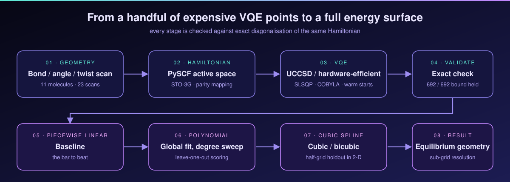

<div align="center">


</div>

# Molecular Simulation on Quantum Computing Systems

Potential-energy surfaces for eleven molecules, computed with the Variational Quantum
Eigensolver (VQE) and then rebuilt from a small number of samples with polynomial and
spline interpolation. Every energy is checked against exact diagonalisation of the same
Hamiltonian, and one calculation was also run on a real IBM quantum processor.

Course project for **CSE 402 — Numerical Analysis, Simulation and Modeling**, BUET
(Group 09, Section A, supervised by Ishrat Jahan). This is my fork of the team repository.

| | |
|---|---|
| **Molecules** | H₂, LiH, BeH₂, H₂O, NH₃, N₂, O₂, F₂, H₂O₂, NO₂, N₂O |
| **Scans** | 23 (bond stretches, bend angles, a dihedral twist, five 2-D surfaces) |
| **VQE optimisations** | 692, each compared with the exact ground-state energy |
| **Variational bound** | held in all 692 (VQE never dipped below the exact energy) |
| **Chemical accuracy** | 14 of 23 scans, several by three to four orders of magnitude |
| **Interpolants scored** | piecewise linear, global polynomial, cubic / bicubic spline, all out of sample |
| **Hardware** | H₂ dissociation curve on `ibm_marrakesh`, 23 bond lengths |

<div align="center">


<sub>BeH₂ ground-state energy surface: 110 VQE points filling in scan order while the molecule
redraws to match. The trough runs along the angle axis, so bending is soft and stretching is stiff.</sub>

</div>

## What the project does

A single VQE point is an optimisation over circuit parameters, so it is slow, and it gets
slower with molecule size. A two-dimensional surface at modest resolution already needs
over a hundred of them. The chemically interesting quantities (equilibrium geometry, well
curvature, barriers) belong to the continuous surface, not to the sampled points. The
project treats this as a numerical-analysis problem: how well can a surface be rebuilt
from few, expensive samples, and which interpolant should you trust?



1. **Scan** a geometry coordinate (bond length, angle, dihedral, or two of them at once).
2. **Build** the active-space Hamiltonian with PySCF and map it to qubits.
3. **Solve** each geometry with VQE (UCCSD, or a hardware-efficient ansatz in the CUDA-Q core), warm-starting from the previous point.
4. **Validate** against exact diagonalisation of the same Hamiltonian.
5. **Reconstruct** the curve or surface with three interpolants, scored by leave-one-out (1-D) or half-grid holdout (2-D).
6. **Recover** equilibrium geometries at sub-grid resolution and compare with reference values.

The full write-up, with theory, per-molecule results and the base-paper review, is in
[`CSE402_report_acm/A_09.pdf`](CSE402_report_acm/A_09.pdf). The base paper is Peruzzo et al.,
*A variational eigenvalue solver on a photonic quantum processor*, Nature Communications 5, 4213 (2014).

## My role

I am Shahraz Hussain Siyam (2105023). On this project I owned the BeH₂ and O₂ work end to
end, the numerical-analysis layer for those two molecules, and the IBM Quantum hardware run.

**BeH₂ campaign**
- Built the BeH₂ VQE driver with three modes: symmetric stretch (16 points), bend (19 points) and a joint bond × angle surface (110 points, the largest scan in the project).
- Constrained the geometry so that only symmetric motion can be expressed, which keeps the molecule in C₂ᵥ (or linear at 180°) at every point.
- Interactive live plot next to the deforming molecule, with save/load so a finished scan never has to be recomputed.

**O₂ campaign**
- Triplet-state VQE scan on an 8-electron, 6-orbital active space (10 qubits, 68 parameters), with selectable optimiser and singlet/triplet switch.

**Interpolation and error analysis (BeH₂ and O₂)**
- Global polynomial reconstruction with a degree sweep, so the degree is chosen from out-of-sample error instead of by eye.
- Cubic spline reconstruction of the same scans, and bicubic surfaces for BeH₂.
- Error plots, dense reconstructions and 3-D surface renders for every scan, all saved as CSV/JSON/PNG.

**IBM Quantum hardware**
- Reworked `qiskit_vqe.py` so the same UCCSD pipeline runs on a real device through Qiskit Runtime.
- Ran a one-point pilot first to measure QPU time per job, then sized the full scan to fit the account budget.
- Executed the 23-point H₂ dissociation scan on `ibm_marrakesh`; job logs and the circuit diagram are in [`ibm_logs/`](ibm_logs/).
- Kept credentials out of version control (`.env.example` template, `apikey.json` ignored).

**Team workflow.** The scan campaign was partitioned by molecule across five contributors
working on separate branches and merged through pull requests, which is how 23 scans and
their interpolation studies were completed inside the course timeline.

## Credits

This repository is a fork of [**QuitttCat/CSE-402-Numerical-Analysis-Simulation-and-Modeling-Project**](https://github.com/QuitttCat/CSE-402-Numerical-Analysis-Simulation-and-Modeling-Project),
the team's shared repository. The project plan, initial setup and repository front page
come from there. Most of the project is collaborative work:

| Contributor | Main contributions |
|---|---|
| **Niloy Kumar Mondal** (2105044) | Core library in `src/`: CUDA-Q molecule interface, 3-D visualisation, VQE implementation, interactive scan tooling and the shared save/load format |
| **Nabiha Tahseen** (2105031) | F₂ and H₂O₂ campaigns, interpolation studies, report and table generator |
| **Debashri Roy** (2105035) | N₂, N₂O and NO₂ campaigns, report layout and compiled PDF |
| **Amit Saha** (2105049) | LiH and NH₃ campaigns |
| **Shahraz Hussain Siyam** (2105023) | BeH₂ and O₂ campaigns, their interpolation analysis, IBM Quantum hardware run |

The ACM template (`acmart`) is by the ACM; VQE and chemistry calculations build on
[NVIDIA CUDA-Q](https://github.com/NVIDIA/cuda-quantum), [PySCF](https://pyscf.org),
[Qiskit](https://qiskit.org) and Qiskit Nature.

## Hardware run

The optimisation loop runs on an exact statevector simulator. Each optimised circuit is
then sent to the device for a single energy evaluation, with error mitigation switched
off to stay within the QPU-time budget.

<div align="center">


</div>

The simulator matches exact diagonalisation to better than 10⁻³ mHa at every point. The
unmitigated hardware energies reproduce the shape of the dissociation curve and the
position of the minimum, with a deviation from exact of 4 to 74 mHa (mean 24 mHa), which
is what device noise looks like without mitigation. Data:
[`h2_energies_hardware.csv`](VQE%20demo%20on%20IBM%20Quantum%20Computer/h2_hardware_results/h2_energies_hardware.csv).

## Repository layout

```
src/                           CUDA-Q core: molecule wrapper + VQE (UCCSD, hardware-efficient, SciPy optimisers)
examples/                      small demos of the core library
experiment/<molecule>/         VQE scan driver + saved scan (JSON/CSV) for each molecule
experiment/<molecule>_polynomial/   polynomial interpolation, degree sweep, error plots
experiment/<molecule>_spline/       cubic / bicubic spline interpolation and error plots
experiment/scan_io.py          shared, versioned save/load format for scans
VQE demo on IBM Quantum Computer/   Qiskit script and results for real hardware
ibm_logs/                      IBM Quantum job record and circuit diagram
CSE402_report_acm/             LaTeX report, figures, generated tables
Presentation slides/           proposal deck and project plan
```

## Running it

Python 3.10+. `cudaq-solvers` (used by `src/`) is Linux/WSL only; the scan drivers and
interpolation scripts need only PySCF, Qiskit Nature and SciPy.

```bash
python -m venv .venv && source .venv/bin/activate
pip install -r requirements.txt
```

**Reopen a saved scan** (no VQE is re-run, takes a few seconds):

```bash
python experiment/beh2/beh2_ground_state_estimation.py --load beh2_surface_scan.json
python experiment/o2/o2_ground_state_estimation.py     --load o2_scan.json
```

**Run a scan**

```bash
# BeH2: stretch, bend, or the joint surface
python experiment/beh2/beh2_ground_state_estimation.py --coordinate stretch
python experiment/beh2/beh2_ground_state_estimation.py --coordinate surface

# O2 triplet, 0.9 to 2.5 Angstrom
python experiment/o2/o2_ground_state_estimation.py --start 0.9 --stop 2.5 --step 0.2

# H2 and H2O
python experiment/h2/h2_ground_state_estimation.py --start 0.3 --stop 2.5 --step 0.1
python experiment/h2o/h2o_ground_state_estimation.py --coordinate bend
```

Finished scans save themselves as `*_scan.json` (energies plus metadata) and `*_scan.csv`
next to the script. Pass `--save NAME` to choose a name or `--no-save` to skip.

**Interpolate a saved scan**

```bash
python experiment/beh2_polynomial/beh2_polynomial_interpolation.py --scan beh2_stretch_scan.json
python experiment/beh2_spline/beh2_spline_interpolation.py         --scan beh2_stretch_scan.json
python experiment/o2_spline/o2_spline_interpolation.py             --scan o2_scan.json
```

**Hardware (optional).** Copy `.env.example` to `.env`, fill in your IBM Quantum CRN and API
key, then run `python "VQE demo on IBM Quantum Computer/qiskit_vqe.py" --backend hardware`.
Without the flag the script runs on a local simulator; on hardware it prints the plan
(backend, circuits, shots) and asks for confirmation before submitting a job.

**Rebuild the report**

```bash
cd CSE402_report_acm
python gen_tables.py     # regenerates tables/ from the saved scans
latexmk -pdf report.tex
```

## Notes on the VQE scans

Two to four minutes per point is typical for the larger active spaces, so a full H₂O
stretch scan takes around 40 minutes, which is why every scan is saved automatically and
can be reloaded. Save files carry a `format_version` and are refused if it does not match,
rather than half-loading.
